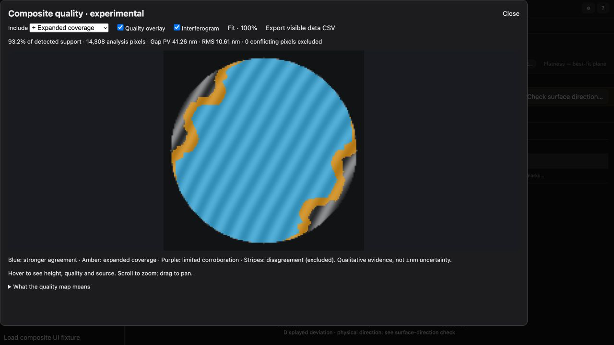

# Single-image composite quality validation

Follow-up: [photographic recovery integration](../fringe-photographic-residual/composite-layer.md) adds a fifth, limited-evidence layer and a comparison toggle. The results below document the earlier stack.

This report records the initial three-layer implementation. The subsequent
[checked continuation and registered capture pairs](checks-and-registration.md)
report documents the current implementation, extra checks, and new experiments.

The application adds an experimental method and dedicated quality viewer. Current remains the default. This is a single-capture composite; source IDs and capture indices are retained for a future multi-capture extension.

## Method and interpretation

Original Hybrid phases are preserved. Strict local-consensus estimates fill missing pixels first, then the studied coverage-first fit (fixed phase/residual threshold equivalent to the earlier 5 nm score at 632.8 nm). There are no 10/20-score extensions. All additions fit actual image intensities and independently anchor to the original measurements; newly filled regions never become anchors. Explicit holes stay excluded.

Quality is evaluated separately from source. Stronger agreement requires strict, unwrapped, anchored corroboration; expanded coverage passes the broader gate. Uncorroborated original measurements are marked limited. Two well-supported wrapped-phase disagreements mark a conflict, excluded from every quantitative cutoff. These checks can share biases and fringe-order errors: the categories are not calibrated measurement uncertainty.

A targeted test found that wrapped agreement alone could promote anchors with inconsistent fringe orders. Corroboration now requires accepted unwrapped components. The earlier holdout records are retained in `holdout-wrapped-corroboration.json`; the final implementation downgrades unsupported regions. This refinement used the holdout results, so these 18 scenes are now development/regression evidence, not untouched validation.

The inspector retains an analysis-time air-gap snapshot, including its own geometry, form removal, wavelength and full-resolution statistics at each cutoff. Cutoffs keep one fixed reference; they do not refit or move the surface. Grid samples use nearest-neighbor sampling so each height and provenance label describe the same pixel. The main result includes all non-conflicting measurements; viewer cutoffs and CSV exports have their own explicit scope. Main-result inversion/form edits do not change this snapshot.

## Numerical regression audit

26 synthetic scenes × 3 inclusion cutoffs. Errors below use a plane aligned on original Hybrid anchors, with analytic truth used only for scoring. Zero coverage has no error estimate.

| Scene | Cutoff | Physical coverage % | Maximum included error nm | Maximum added error nm |
|---|---:|---:|---:|---:|
| narrow-roll-17.4 | 1 | 77.5 | 5.03 | 5.03 |
| narrow-roll-17.4 | 2 | 98.1 | 8.82 | 8.82 |
| narrow-roll-17.4 | 3 | 98.1 | 8.82 | 8.82 |
| noisy-hole-flat | 1 | 94.6 | 0.95 | 0.95 |
| noisy-hole-flat | 2 | 99.0 | 2.35 | 2.35 |
| noisy-hole-flat | 3 | 99.0 | 2.35 | 2.35 |
| oversized-flat | 1 | 52.3 | 0.27 | — |
| oversized-flat | 2 | 61.0 | 0.33 | 0.33 |
| oversized-flat | 3 | 66.3 | 0.33 | 0.33 |
| precise-weak-rim | 1 | 79.9 | 1.38 | 1.38 |
| precise-weak-rim | 2 | 93.7 | 11.15 | 11.15 |
| precise-weak-rim | 3 | 93.7 | 11.15 | 11.15 |
| challenge-blur-56 | 1 | 0.0 | — | — |
| challenge-blur-56 | 2 | 81.2 | 33.60 | 33.60 |
| challenge-blur-56 | 3 | 81.2 | 33.60 | 33.60 |
| challenge-blur-119 | 1 | 0.0 | — | — |
| challenge-blur-119 | 2 | 80.8 | 29.42 | 29.42 |
| challenge-blur-119 | 3 | 80.8 | 29.42 | 29.42 |
| challenge-loose-11 | 1 | 31.6 | 0.81 | — |
| challenge-loose-11 | 2 | 47.3 | 20.45 | 20.45 |
| challenge-loose-11 | 3 | 69.3 | 20.45 | 20.45 |
| holdout-scratch-24 | 1 | 20.4 | 111.55 | 111.55 |
| holdout-scratch-24 | 2 | 47.4 | 189.55 | 189.55 |
| holdout-scratch-24 | 3 | 59.2 | 189.55 | 189.55 |
| budget-holdout-flat-0 | 1 | 92.7 | 0.41 | 0.41 |
| budget-holdout-flat-0 | 2 | 98.3 | 1.31 | 1.31 |
| budget-holdout-flat-0 | 3 | 98.3 | 1.31 | 1.31 |
| budget-holdout-flat-1 | 1 | 91.5 | 1.01 | 1.01 |
| budget-holdout-flat-1 | 2 | 98.4 | 1.01 | 1.01 |
| budget-holdout-flat-1 | 3 | 98.4 | 1.01 | 1.01 |
| budget-holdout-flat-2 | 1 | 40.2 | 0.31 | — |
| budget-holdout-flat-2 | 2 | 51.7 | 0.71 | 0.46 |
| budget-holdout-flat-2 | 3 | 65.4 | 0.71 | 0.46 |
| budget-holdout-saddle-0 | 1 | 95.8 | 0.62 | 0.62 |
| budget-holdout-saddle-0 | 2 | 99.1 | 0.93 | 0.93 |
| budget-holdout-saddle-0 | 3 | 99.1 | 0.93 | 0.93 |
| budget-holdout-saddle-1 | 1 | 93.4 | 1.33 | 1.33 |
| budget-holdout-saddle-1 | 2 | 99.1 | 2.95 | 2.95 |
| budget-holdout-saddle-1 | 3 | 99.1 | 2.95 | 2.95 |
| budget-holdout-saddle-2 | 1 | 32.0 | 0.32 | — |
| budget-holdout-saddle-2 | 2 | 45.2 | 1.05 | — |
| budget-holdout-saddle-2 | 3 | 65.8 | 1.37 | — |
| budget-holdout-roll-0 | 1 | 90.9 | 3.51 | 3.51 |
| budget-holdout-roll-0 | 2 | 98.8 | 5.88 | 5.88 |
| budget-holdout-roll-0 | 3 | 98.8 | 5.88 | 5.88 |
| budget-holdout-roll-1 | 1 | 56.8 | 2.60 | 2.60 |
| budget-holdout-roll-1 | 2 | 98.2 | 6.52 | 6.52 |
| budget-holdout-roll-1 | 3 | 98.2 | 6.52 | 6.52 |
| budget-holdout-roll-2 | 1 | 56.9 | 0.82 | 0.61 |
| budget-holdout-roll-2 | 2 | 67.0 | 4.36 | 4.36 |
| budget-holdout-roll-2 | 3 | 67.7 | 4.36 | 4.36 |
| budget-holdout-bump-0 | 1 | 83.9 | 1.10 | 1.10 |
| budget-holdout-bump-0 | 2 | 96.8 | 5.61 | 5.61 |
| budget-holdout-bump-0 | 3 | 97.7 | 10.69 | 5.61 |
| budget-holdout-bump-1 | 1 | 77.0 | 1.16 | 0.72 |
| budget-holdout-bump-1 | 2 | 95.9 | 4.13 | 4.13 |
| budget-holdout-bump-1 | 3 | 97.5 | 11.95 | 4.13 |
| budget-holdout-bump-2 | 1 | 18.3 | 0.40 | — |
| budget-holdout-bump-2 | 2 | 33.1 | 2.03 | — |
| budget-holdout-bump-2 | 3 | 62.9 | 4.49 | — |
| budget-holdout-weak-rim-0 | 1 | 49.0 | 0.84 | 0.84 |
| budget-holdout-weak-rim-0 | 2 | 91.7 | 5.51 | 5.51 |
| budget-holdout-weak-rim-0 | 3 | 91.7 | 5.51 | 5.51 |
| budget-holdout-weak-rim-1 | 1 | 35.4 | 0.95 | 0.95 |
| budget-holdout-weak-rim-1 | 2 | 86.7 | 3.69 | 3.69 |
| budget-holdout-weak-rim-1 | 3 | 86.7 | 3.69 | 3.69 |
| budget-holdout-weak-rim-2 | 1 | 35.0 | 0.32 | — |
| budget-holdout-weak-rim-2 | 2 | 50.4 | 1.97 | 1.97 |
| budget-holdout-weak-rim-2 | 3 | 52.5 | 1.97 | 1.97 |
| budget-holdout-defect-0 | 1 | 78.6 | 1.04 | 1.04 |
| budget-holdout-defect-0 | 2 | 87.9 | 1.53 | 1.53 |
| budget-holdout-defect-0 | 3 | 97.5 | 186.09 | 1.53 |
| budget-holdout-defect-1 | 1 | 71.6 | 1.19 | 0.84 |
| budget-holdout-defect-1 | 2 | 87.8 | 1.46 | 1.46 |
| budget-holdout-defect-1 | 3 | 90.8 | 1.78 | 1.46 |
| budget-holdout-defect-2 | 1 | 27.9 | 1.69 | — |
| budget-holdout-defect-2 | 2 | 40.7 | 1.81 | 1.69 |
| budget-holdout-defect-2 | 3 | 65.5 | 214.07 | 1.69 |

All audited cutoffs admit zero background pixels and zero new fringe-free defect pixels. The audit asserts preservation of the original Hybrid phases before form removal. The scratch failure still has >100 nm error even at the strongest category; this is direct evidence that the heatmap must not be presented as an uncertainty guarantee. In contrast, the defect holdouts move their large inherited baseline errors into the limited category, excluded by the default expanded cutoff.

## UI and browser checks

- 843 frontend tests passed, including cutoff nesting, fixed height/scale, conflict exclusion, provenance export and snapshot persistence.
- 68 targeted backend/browser/research tests passed; the final composite suite passed 10 tests, including an inconsistent-fringe-order regression and all three server analysis routes with capture-history round trips.
- Native vs Pyodide parity: automatic and drawn apertures have identical display grids, masks, source categories, quality categories and conflict masks; full-resolution summary differences <0.005 nm.
- Manual browser workflow: select Composite, analyze in browser, automatic viewer opening, change all cutoffs, toggle heatmap and photograph, zoom/fit, export CSV, close/reopen and restore saved project after reload.
- Full-resolution cutoff summaries on the automatic synthetic rolled edge: 84.2% → 93.2% coverage, PV 40.06 → 41.26 nm.



## Reproduce

```sh
OPENBLAS_NUM_THREADS=1 MPLCONFIGDIR=/tmp/loupe-mpl .venv/bin/python scripts/experiment-fringe-composite.py --suite regression --output /tmp/composite-regression.json
OPENBLAS_NUM_THREADS=1 MPLCONFIGDIR=/tmp/loupe-mpl .venv/bin/python scripts/experiment-fringe-composite.py --suite budget-holdout --output /tmp/composite-holdout.json
OPENBLAS_NUM_THREADS=1 MPLCONFIGDIR=/tmp/loupe-mpl .venv/bin/python scripts/prepare-fringe-composite-validation.py /tmp/loupe-composite-preview/frontend
```

Serve the generated frontend with the current backend on an isolated local origin. Open `/fringe-validation.html` for native/browser parity, and `/fringe-composite-ui.html` for the synthetic real-UI fixture. No real user image is used in these tests.
