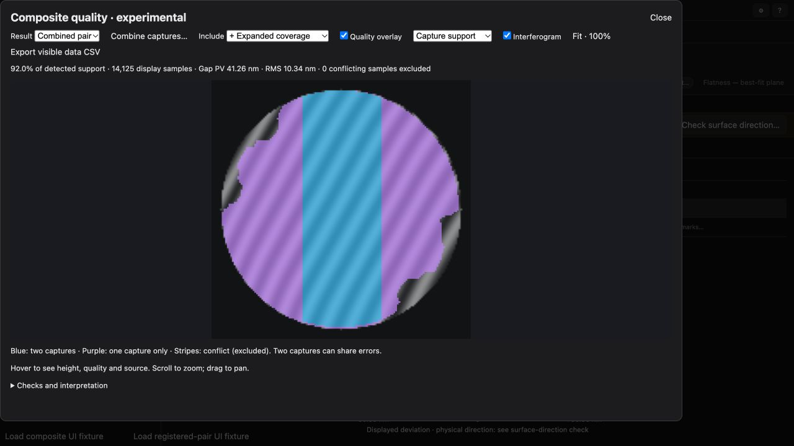

# Checked continuation, fringe-order diagnostics, and registered capture pairs

This iteration integrates the previous mathematical prototypes with the experimental
Composite quality viewer. Current remains the default. This is an engineering
validation on synthetic inputs, not a calibration or real-part accuracy claim.

## What changed

The single-image stack now has a fourth, last-priority layer: checked fringe
continuation. A quadratic phase/illumination prediction fills only the exterior
used by the filter; candidate measurements still come from the real selected
image. The prediction must pass a withheld rim check (95th-percentile phase
residual at most 0.01 rad), local structured-residual checks, original-anchor
agreement and an alternate unwrap-path check. Passing additions are categorized
**Limited corroboration**; they never overwrite the earlier layers. Failed
regions cannot bridge into disconnected recovery. No synthetic exterior pixel
becomes a measurement.

Before continuation, a deterministic scikit-image unwrap of the wrapped composite
is compared with its existing order. An arbitrary integer piston is allowed per
connected island. Disagreement quarantines the entire affected island: neither
path is assumed correct. This catches shared order errors that agreement among
local fits missed. It does not verify the relative order of disconnected islands,
continuous phase bias, optical distortion or the physical sign. Islands with
fewer than 25 pixels cannot be checked. When fewer than the normal minimum of
reliable pixels survive, the application reports an explicit fringe-order error
instead of producing a flatness number. The viewer and CSV retain disagreement
reasons for results that have sufficient remaining support.

The viewer also combines **two** original Composite quality captures from the
current session. Both must use Plane removal. Three corresponding landmarks fit
a similarity transform in image-pixel coordinates, including rectangular images;
reflections, near-collinearity and landmark errors above 2.5 analysis pixels are
rejected. Users explicitly confirm relative analysis-time height direction.
Heights are resampled only where all four interpolation neighbors are measured,
inside the incoming aperture and non-conflicting. Offset and tilt are robustly
aligned using stronger/expanded overlap; curvature is not fitted away. At least
100 overlap samples spanning a quarter of both image dimensions are required.
An alternating 8×8 block holdout checks the 90th-percentile disagreement against
the user's limit (20 nm initially). This is an admission threshold, not an error
budget or uncertainty estimate.

The best evidence category wins at each location, with reference capture winning
ties. No height averaging hides disagreements. Overlap differences exceeding the
limit are excluded. Single-support cells are at least Expanded coverage, with
unknown repeatability. The display offers fit evidence, capture support and
overlap difference separately; CSV carries provenance, support, difference and
conflict reasons. Existing reference conflicts remain excluded even if the other
capture has a value there. The combined map is restricted to the reference
aperture, with statistics on the display grid (at most 256×256). Single-capture
statistics remain full-resolution. The combined snapshot and registration survive
project reload; temporary source capture history is not saved with it.

## Single-image experiment

`checked-regression.json` and `checked-holdout.json` rerun the same 26 scenes and
three cutoffs (78 records). The old files remain available for comparison. All
admission rules use image evidence; synthetic truth is used only for scoring.
Errors below use the same original-anchor alignment as the earlier study.

At the most permissive cutoff:

| Scene | Previous coverage | New coverage | Previous max error | New max error |
|---|---:|---:|---:|---:|
| Noisy flat with hole | 99.01% | 100.00% | 2.35 nm | 2.35 nm |
| Oversized flat | 66.33% | 75.93% | 0.33 nm | 8.90 nm |
| Holdout flat 0 | 98.34% | 100.00% | 1.31 nm | 1.31 nm |
| Holdout flat 2 | 65.42% | 73.60% | 0.71 nm | 2.01 nm |
| Holdout saddle 2 | 65.79% | 72.14% | 1.37 nm | 1.89 nm |
| Holdout roll 2 | 67.68% | 70.31% | 4.36 nm | 4.60 nm |

The oversized flat illustrates the cost of extra coverage: additions are not
uniformly as accurate as existing measurements. They stay in the last tier.
The known narrow rolled edge is unchanged at 98.1% coverage / 8.82 nm maximum
error; the weak rim is unchanged at 93.7% / 11.15 nm. No record adds pixels outside
the physical aperture or into the designated fringe-free defect regions.

The scratch case's ambiguous 10,354-pixel island is rejected. One tiny remaining
sample still has large error (about 190 nm), so the numerical research report
must not be read as a successful reconstruction: the application's minimum-support
rule rejects the capture. The two problematic defect holdouts similarly lose all
quantitative support and are rejected. This is intentional loss of misleading
coverage, not an automatic correction. The blurred fixtures remain problematic
at roughly 29–34 nm maximum error. Continuous/shared bias can pass these checks;
the colors are still qualitative evidence, not calibrated uncertainty.

## Registration experiment

`registration.json` records 24 analytic **display-grid** cases: three relative
rotations, both height signs, and clean/noisy/local-defect/incompatible-curvature
variants. These test registration and combining separately from interferogram
reconstruction. Complementary selected areas, an excluded hole, an asymmetric
localized surface feature and rectangular image geometry are included.

All six incompatible-curvature pairs were rejected by the held-out overlap check.
The 18 accepted pairs raised approximately 78.27% reference coverage to
97.86–99.12%, with worst added-area error below 0.802 nm and zero added pixels
outside the reference aperture. Local 40 nm discrepancies in overlap were marked
conflicting and excluded. This suite used a 5 nm disagreement limit; the UI starts
at 20 nm, which the user can change. These results do not establish real-world
repeatability or the accuracy of either input reconstruction.

## Verification and reproduction

Final checks: 851 frontend tests and 43 targeted Python tests passed. All three
browser/native parity fixtures passed. Existing dependency deprecation warnings
remain. `checked-source-sha256.json` records the implementation used for this run.

- Frontend tests cover registration geometry, wrong curvature, relative sign,
  holes, preserved original heights, conflict exclusion, cutoff/CSV provenance,
  maximum-size grids and JSON restoration.
- Python tests cover layer preservation, cutoffs, continuation through a real
  image, order-slip detection versus arbitrary island piston, complete rejection
  of an ambiguous capture, and all three API analysis routes/history round-trip.
- Native Python / browser parity covers auto mask, drawn mask, and a flat annulus
  exercising continuation: exact masks, quality/source/reason grids and serialized
  displayed heights. Numerical PV differences were below 0.000001 nm.
- UI checked on an isolated local origin: saved-landmark registration, the support
  and disagreement overlays, cutoff changes, and restoration of the combined
  snapshot after reload. The screenshot is a deliberately complementary-support
  UI fixture, not two independent experimental measurements.



```sh
OPENBLAS_NUM_THREADS=1 MPLCONFIGDIR=/tmp/loupe-mpl .venv/bin/python scripts/experiment-fringe-composite.py --output experiments/fringe-composite/checked-regression.json
OPENBLAS_NUM_THREADS=1 MPLCONFIGDIR=/tmp/loupe-mpl .venv/bin/python scripts/experiment-fringe-composite.py --suite budget-holdout --output experiments/fringe-composite/checked-holdout.json
node scripts/experiment-fringe-registration.mjs experiments/fringe-composite/registration.json
node --test tests/frontend/*.js
OPENBLAS_NUM_THREADS=1 MPLCONFIGDIR=/tmp/loupe-mpl .venv/bin/pytest tests/test_fringe_composite.py tests/test_fringe_browser.py tests/test_fringe_continuation_checks.py tests/test_fringe_hybrid.py -q
OPENBLAS_NUM_THREADS=1 MPLCONFIGDIR=/tmp/loupe-mpl .venv/bin/python scripts/prepare-fringe-composite-validation.py /tmp/loupe-composite-checks/frontend
```

The continuation model and residual gates come from the earlier
[continuation study](../fringe-continuation-checks/README.md) and its linked sources.
The alternate-path quarantine and capture-pair admission policy are engineering
checks introduced here, not claims of a published uncertainty model or novelty.
