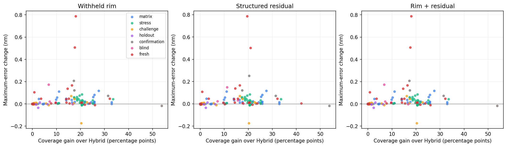
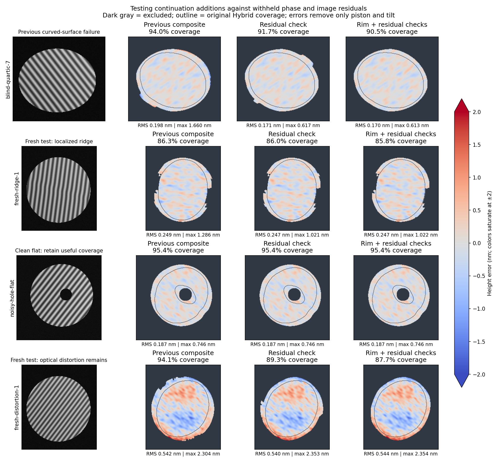

# Testing continuation admission checks

## Scope

Research only: the application’s Current and Hybrid algorithms are unchanged. This follows the [edge-recovery study](../fringe-edge-recovery/README.md), whose padded continuation could pass image-error checks while adding biased phase on a quartic surface. The new checks restrict continuation additions; all existing Hybrid and accepted selective-local-fit values are preserved.

1890 suite evaluations across 210 distinct synthetic scenes. The original 174 scenes are development/reused evidence. All five new variants and their thresholds were specified before running 36 fresh scenes; none were adjusted against that set. Pilot reruns are omitted from this count. Full numerical records, dependency versions and source hashes accompany this report.

## Admission rules

- **Withheld rim:** fit quadratic phase on original Hybrid anchors more than one fringe period from the anchor boundary. Predict the held-out outer rim and require its 95th-percentile absolute phase discrepancy to be ≤0.01 rad. Require at least 100 training and 25 validation pixels and a full-rank fit. Failure disables continuation, retaining the selective local bank.
- **Withheld directional strips:** repeat with the left/right/top/bottom 20% coordinate strips held out separately. All four predictions must satisfy the same 0.01-rad criterion.
- **Structured residual:** fit the same quadratic phase/illumination continuation model. In Gaussian windows of sigma half a fringe period, regress the remaining image error on offset, carrier amplitude and phase derivative. Offset/amplitude are nuisance terms. Reject phase-like bias exceeding both 0.01 rad and three estimated standard errors. The covariance uses squared discrete Gaussian weights; noise comes from a robust diagonal high-pass estimate. This is an iid-noise approximation, not a calibrated uncertainty guarantee.
- **Combined variants:** require both the global rim/strip check and the local residual check. Added continuation pixels must remain connected through accepted continuation pixels to original Hybrid anchors. Newly added local-fit pixels cannot start growth.

The previous global and local image-model gates, original-anchor checks and aperture constraints remain in force. The checks use no analytic truth or physical-outline oracle. Withheld phase is still a reconstructed estimate from the same photograph, so validation agreement is correlated evidence.

## Results

Coverage is relative to the known physical aperture. RMS is averaged per scene. Worst Δ max is the largest increase in maximum error relative to Hybrid; it is not an instrument accuracy bound. A plane is removed for scoring, never curvature or scale. Added-area error uses a reference plane fitted on original Hybrid pixels only.

### matrix (36 scenes)

| Method | Mean coverage % | Mean RMS nm | Worst Δ max nm | Largest added-area error nm |
|---|---:|---:|---:|---:|
| Hybrid | 63.28 | 0.218 | 0.000 | — |
| Selective local fits | 73.02 | 0.218 | 0.114 | 2.253 |
| Padded continuation alone | 72.26 | 0.219 | 0.055 | 0.665 |
| Previous composite | 76.09 | 0.219 | 0.117 | 2.253 |
| Withheld rim | 76.09 | 0.219 | 0.117 | 2.253 |
| Withheld directional strips | 75.94 | 0.219 | 0.114 | 2.253 |
| Structured residual | 76.09 | 0.219 | 0.117 | 2.253 |
| Rim + residual | 76.09 | 0.219 | 0.117 | 2.253 |
| Strips + residual | 75.94 | 0.219 | 0.114 | 2.253 |

### stress (60 scenes)

| Method | Mean coverage % | Mean RMS nm | Worst Δ max nm | Largest added-area error nm |
|---|---:|---:|---:|---:|
| Hybrid | 64.21 | 0.259 | 0.000 | — |
| Selective local fits | 70.07 | 0.259 | 0.086 | 0.550 |
| Padded continuation alone | 72.64 | 0.258 | 0.041 | 0.495 |
| Previous composite | 73.17 | 0.259 | 0.086 | 0.550 |
| Withheld rim | 73.17 | 0.259 | 0.086 | 0.550 |
| Withheld directional strips | 73.17 | 0.259 | 0.086 | 0.550 |
| Structured residual | 73.17 | 0.259 | 0.086 | 0.550 |
| Rim + residual | 73.17 | 0.259 | 0.086 | 0.550 |
| Strips + residual | 73.17 | 0.259 | 0.086 | 0.550 |

### challenge (30 scenes)

| Method | Mean coverage % | Mean RMS nm | Worst Δ max nm | Largest added-area error nm |
|---|---:|---:|---:|---:|
| Hybrid | 61.58 | 0.935 | 0.000 | — |
| Selective local fits | 64.71 | 0.928 | 0.070 | 1.017 |
| Padded continuation alone | 64.14 | 0.938 | 0.017 | 1.219 |
| Previous composite | 65.64 | 0.932 | 0.072 | 1.219 |
| Withheld rim | 65.38 | 0.932 | 0.070 | 1.219 |
| Withheld directional strips | 65.20 | 0.933 | 0.070 | 1.219 |
| Structured residual | 65.59 | 0.932 | 0.071 | 1.219 |
| Rim + residual | 65.38 | 0.932 | 0.070 | 1.219 |
| Strips + residual | 65.20 | 0.933 | 0.070 | 1.219 |

### holdout (24 scenes)

| Method | Mean coverage % | Mean RMS nm | Worst Δ max nm | Largest added-area error nm |
|---|---:|---:|---:|---:|
| Hybrid | 52.72 | 2.789 | 0.000 | — |
| Selective local fits | 53.32 | 2.789 | 0.013 | 1.253 |
| Padded continuation alone | 52.72 | 2.789 | 0.003 | 1.345 |
| Previous composite | 53.32 | 2.789 | 0.013 | 1.345 |
| Withheld rim | 53.32 | 2.789 | 0.013 | 1.253 |
| Withheld directional strips | 53.32 | 2.789 | 0.013 | 1.253 |
| Structured residual | 53.32 | 2.789 | 0.013 | 1.253 |
| Rim + residual | 53.32 | 2.789 | 0.013 | 1.253 |
| Strips + residual | 53.32 | 2.789 | 0.013 | 1.253 |

### confirmation (12 scenes)

| Method | Mean coverage % | Mean RMS nm | Worst Δ max nm | Largest added-area error nm |
|---|---:|---:|---:|---:|
| Hybrid | 48.76 | 1.076 | 0.000 | — |
| Selective local fits | 54.85 | 1.056 | 0.208 | 1.786 |
| Padded continuation alone | 58.69 | 1.055 | 0.257 | 1.739 |
| Previous composite | 59.31 | 1.049 | 0.270 | 1.786 |
| Withheld rim | 58.77 | 1.055 | 0.208 | 1.786 |
| Withheld directional strips | 58.77 | 1.055 | 0.208 | 1.786 |
| Structured residual | 59.04 | 1.052 | 0.253 | 1.786 |
| Rim + residual | 58.77 | 1.055 | 0.208 | 1.786 |
| Strips + residual | 58.77 | 1.055 | 0.208 | 1.786 |

### blind (12 scenes)

| Method | Mean coverage % | Mean RMS nm | Worst Δ max nm | Largest added-area error nm |
|---|---:|---:|---:|---:|
| Hybrid | 57.81 | 1.381 | 0.000 | — |
| Selective local fits | 61.16 | 1.372 | 0.173 | 1.917 |
| Padded continuation alone | 62.23 | 1.371 | 1.046 | 1.660 |
| Previous composite | 62.92 | 1.369 | 1.045 | 1.917 |
| Withheld rim | 61.16 | 1.372 | 0.173 | 1.917 |
| Withheld directional strips | 61.16 | 1.372 | 0.173 | 1.917 |
| Structured residual | 62.14 | 1.367 | 0.150 | 1.917 |
| Rim + residual | 61.16 | 1.372 | 0.173 | 1.917 |
| Strips + residual | 61.16 | 1.372 | 0.173 | 1.917 |

### fresh (36 scenes)

| Method | Mean coverage % | Mean RMS nm | Worst Δ max nm | Largest added-area error nm |
|---|---:|---:|---:|---:|
| Hybrid | 60.10 | 0.839 | 0.000 | — |
| Selective local fits | 67.16 | 0.837 | 0.787 | 4.030 |
| Padded continuation alone | 66.88 | 0.840 | 0.263 | 3.449 |
| Previous composite | 69.50 | 0.837 | 0.737 | 4.030 |
| Withheld rim | 68.20 | 0.837 | 0.787 | 4.030 |
| Withheld directional strips | 68.20 | 0.837 | 0.787 | 4.030 |
| Structured residual | 68.94 | 0.836 | 0.786 | 4.030 |
| Rim + residual | 68.20 | 0.837 | 0.787 | 4.030 |
| Strips + residual | 68.20 | 0.837 | 0.787 | 4.030 |





## Findings and decision

The local structured-residual check is the more useful next candidate: it can reject a biased portion of continuation while retaining other additions. Global cross-validation is more conservative and rejects some useful additions wholesale. Combining both inherits that coverage cost; the tables retain all alternatives rather than choosing by average RMS alone.

- On the prior quartic failure, the previous composite reaches 93.95% coverage with 1.660 nm maximum error. The residual check retains about 91.7% and reduces maximum error to about 0.617 nm. Rim validation falls back to the local bank (90.51%, 0.613 nm).
- The fresh localized-ridge case (`fresh-ridge-1`) improves from approximately 1.286 nm maximum error to 1.021 nm with the residual check, while retaining about 86% coverage.
- The clean noisy flat with a hole retains 95.4% coverage under the rim or residual checks. Directional-strip validation drops it to 89.9%, showing that extra checks can be unnecessarily restrictive.
- Fresh distorted-carrier cases still regress. The retained local bank already contains the added-area error (up to about 2.8 nm against the original-anchor plane); a continuation-only gate cannot fix it. Removing some continuation also changes the fitted scoring plane, so the full-map maximum can rise slightly despite retaining exactly the same problematic local-bank heights.

Keep these as research prototypes. The new checks address the identified continuation failure and improve fresh ridge cases, but the study does not establish a universal accuracy bound or justify complete aperture filling. No new application mode or default change is made.

## Limitations and interpretation

Neither a passing cross-validation check nor a small residual proves true surface height. Camera distortion, correlated noise, fringe-order mistakes and common model bias can survive. These rules preserve existing local-fit and Hybrid errors by design. Adding clean pixels can lower full-map RMS while leaving a serious defect unchanged. Compare maximum and added-area errors alongside coverage.

The fresh suite varies frame dimensions (including odd rectangular sizes), carrier direction and pitch, noise, quartic surfaces, localized bumps/ridges, abrupt roll-off, holes, contrast falloff, illumination, gamma response, distorted carriers and defects. The distorted-carrier cases score against part height excluding the optical artifact; the checks cannot establish lens calibration. Real-part validation remains separate.

## Verification

44 targeted tests passed across the new checks, edge-recovery prototypes, production Hybrid and earlier local-fit experiments. Tests cover true quadratic prediction, withheld-region failure, missing support, coherent phase bias versus offset/amplitude changes, white noise, unselected-pixel independence, connected admission, exact original-value preservation, truth-independent reconstruction and cache invalidation. Existing dependency warnings remain.

## Reproduce

```sh
export OPENBLAS_NUM_THREADS=1 MPLCONFIGDIR=/tmp/loupe-mpl
for suite in matrix stress challenge holdout confirmation blind fresh; do
  .venv/bin/python scripts/experiment-fringe-continuation-checks.py --suite "$suite" --output "/tmp/loupe-checks-$suite.json"
done
.venv/bin/python scripts/report-fringe-continuation-checks.py
.venv/bin/python scripts/plot-fringe-continuation-checks.py
```

Baseline arrays are cached under `/tmp/loupe-continuation-cache`, keyed by the image, custom mask and baseline implementation hashes. Analytic truth is not cached; every score is recomputed. The initial automatic-mask cache bug was repaired without changing an admission rule, and that suite was rerun. Prior study files are preserved.

## Sources

These are new engineering hypotheses building on the [previous study’s references](../fringe-edge-recovery/README.md#scientific-guidance), particularly the distinction between local phase estimation and modeled fringe continuation. The strip checks and residual admission rules are our own prototypes, not reproductions of a published algorithm.
