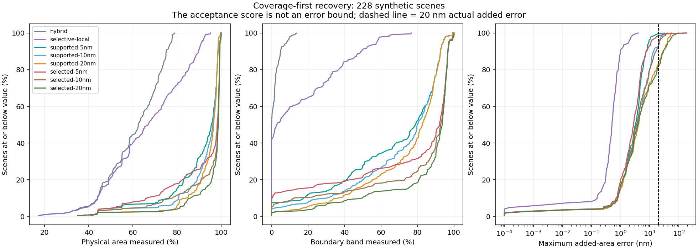
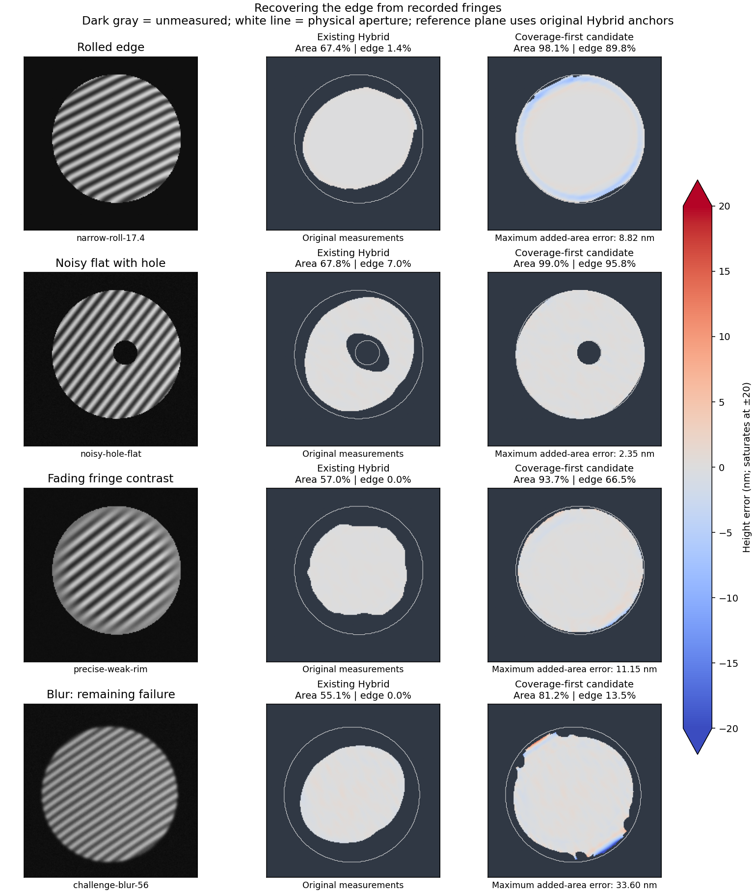

# Recovering more of a lapped part

Research only. Production Current/Hybrid algorithms and browser UI are unchanged. The objective is useful physical-aperture coverage, particularly the rolled edge, with errors assessed against a practical tens-of-nanometers target. Earlier experiments emphasized much smaller errors and discarded substantial usable area.

## Experiment

1,824 evaluations across 228 synthetic scenes: 210 reused scenes plus 18 new holdouts specified after the six-case pilot, without changing the six admission rules. Reused scenes are development evidence. The pilot (48 evaluations) and a subsequent failed rim-control experiment (18 evaluations on three known failures) are archived separately and excluded from the main count.

Three quadratic local fringe fits use Gaussian windows of (across, along) = (0.35, 0.175), (0.5, 0.25), and (0.5, 0.5) fringe periods. Each is compared with a window 1.3 times wider. Require amplitude >10 gray levels, condition <10,000, two agreeing fit candidates, connectivity to original Hybrid anchors, and the existing 0.05-rad anchor agreement check. Remove the earlier one-period growth limit and one-pixel erosion. Existing Hybrid measurements are preserved exactly. These are fits to recorded image intensities, not painted or interpolated surface patches.

**Supported** fits use the existing analysis support mask. **Selected** fits can recover pixels excluded upstream, using the user-selected aperture (or existing support if no selection exists). The known physical outline and true surface enter scoring only. Some selections are deliberately oversized. All variants preserve explicit aperture exclusions for new pixels.

The admission score is wavelength/(4π) times the larger of cross-window phase disagreement and normalized intensity-fit residual. Thresholds of 5, 10, and 20 nm are experimental **scores, not calibrated error bounds**. Agreement among correlated fits can hide common bias. The data below explicitly tests and disproves interpreting those thresholds as guaranteed errors.

## Scoring

- Area coverage counts included pixels inside the true physical aperture, divided by its area.
- Edge coverage uses a boundary band with width 10% of the equivalent aperture radius (minimum two pixels), including hole boundaries. A high area percentage can conceal a missing edge.
- Added-area error removes only a reference plane fitted on original Hybrid anchors. Newly admitted pixels cannot improve their score by changing that reference plane.
- Full-aperture PV discrepancy compares recovered PV with true PV after a plane fit across the entire physical aperture. This is distinct from the also-archived included-area PV error. Both are synthetic diagnostics, not certified instrument uncertainty.

## Results

Each row averages coverage per scene. Worst added error is the maximum over all newly included pixels and scenes. “>20” counts scenes with added-area error exceeding 20 nm; it does not certify the remaining scene’s original measurements or total physical uncertainty.

### matrix: 36 scenes

| Method / score | Area % | Edge % | Worst added error nm | >20 nm scenes | Mean full-aperture PV discrepancy nm |
|---|---:|---:|---:|---:|---:|
| hybrid | 63.3 | 1.2 | — | 0 | 8.50 |
| selective-local | 73.0 | 21.2 | 2.25 | 0 | 7.91 |
| supported-5nm | 88.4 | 63.6 | 10.49 | 0 | 3.96 |
| supported-10nm | 89.4 | 65.5 | 23.68 | 5 | 8.20 |
| supported-20nm | 89.9 | 67.8 | 42.08 | 6 | 13.77 |
| selected-5nm | 88.5 | 70.3 | 17.38 | 0 | 2.84 |
| selected-10nm | 90.2 | 73.1 | 35.16 | 4 | 7.70 |
| selected-20nm | 91.7 | 76.5 | 96.05 | 5 | 17.34 |

### stress: 60 scenes

| Method / score | Area % | Edge % | Worst added error nm | >20 nm scenes | Mean full-aperture PV discrepancy nm |
|---|---:|---:|---:|---:|---:|
| hybrid | 64.2 | 2.9 | — | 0 | 9.36 |
| selective-local | 70.1 | 21.2 | 0.55 | 0 | 8.62 |
| supported-5nm | 95.2 | 79.2 | 7.27 | 0 | 2.24 |
| supported-10nm | 95.2 | 79.4 | 8.98 | 0 | 2.39 |
| supported-20nm | 95.2 | 79.4 | 8.98 | 0 | 2.39 |
| selected-5nm | 97.0 | 87.8 | 7.27 | 0 | 2.58 |
| selected-10nm | 97.1 | 88.0 | 8.16 | 0 | 2.73 |
| selected-20nm | 97.1 | 88.0 | 8.16 | 0 | 2.73 |

### challenge: 30 scenes

| Method / score | Area % | Edge % | Worst added error nm | >20 nm scenes | Mean full-aperture PV discrepancy nm |
|---|---:|---:|---:|---:|---:|
| hybrid | 61.6 | 2.1 | — | 0 | 26.47 |
| selective-local | 64.7 | 9.9 | 1.02 | 0 | 23.80 |
| supported-5nm | 83.2 | 50.8 | 18.66 | 0 | 18.19 |
| supported-10nm | 88.9 | 63.1 | 31.34 | 5 | 18.26 |
| supported-20nm | 93.8 | 72.5 | 57.47 | 12 | 24.17 |
| selected-5nm | 82.3 | 51.5 | 33.60 | 3 | 20.42 |
| selected-10nm | 90.0 | 70.4 | 39.62 | 5 | 19.83 |
| selected-20nm | 96.4 | 84.9 | 58.43 | 15 | 25.19 |

### holdout: 24 scenes

| Method / score | Area % | Edge % | Worst added error nm | >20 nm scenes | Mean full-aperture PV discrepancy nm |
|---|---:|---:|---:|---:|---:|
| hybrid | 52.7 | 0.9 | — | 0 | 44.78 |
| selective-local | 53.3 | 2.1 | 1.25 | 0 | 44.72 |
| supported-5nm | 83.9 | 54.8 | 189.57 | 1 | 23.33 |
| supported-10nm | 84.2 | 57.6 | 20.64 | 2 | 19.74 |
| supported-20nm | 88.5 | 64.8 | 51.64 | 6 | 22.19 |
| selected-5nm | 85.1 | 60.0 | 189.55 | 1 | 24.21 |
| selected-10nm | 86.1 | 66.5 | 19.91 | 0 | 18.73 |
| selected-20nm | 90.9 | 75.5 | 51.64 | 6 | 20.35 |

### confirmation: 12 scenes

| Method / score | Area % | Edge % | Worst added error nm | >20 nm scenes | Mean full-aperture PV discrepancy nm |
|---|---:|---:|---:|---:|---:|
| hybrid | 48.8 | 0.1 | — | 0 | 16.35 |
| selective-local | 54.8 | 10.5 | 1.79 | 0 | 16.06 |
| supported-5nm | 86.0 | 66.9 | 10.73 | 0 | 11.14 |
| supported-10nm | 95.4 | 81.1 | 23.17 | 1 | 15.89 |
| supported-20nm | 96.3 | 83.1 | 33.86 | 3 | 19.23 |
| selected-5nm | 87.3 | 73.6 | 10.92 | 0 | 11.17 |
| selected-10nm | 97.2 | 90.2 | 21.76 | 2 | 15.77 |
| selected-20nm | 98.0 | 92.1 | 26.80 | 3 | 18.11 |

### blind: 12 scenes

| Method / score | Area % | Edge % | Worst added error nm | >20 nm scenes | Mean full-aperture PV discrepancy nm |
|---|---:|---:|---:|---:|---:|
| hybrid | 57.8 | 1.1 | — | 0 | 33.28 |
| selective-local | 61.2 | 12.2 | 1.92 | 0 | 32.66 |
| supported-5nm | 91.5 | 65.0 | 9.44 | 0 | 32.34 |
| supported-10nm | 94.2 | 70.2 | 18.13 | 0 | 35.72 |
| supported-20nm | 94.4 | 70.9 | 30.15 | 3 | 39.87 |
| selected-5nm | 93.9 | 78.1 | 12.04 | 0 | 32.49 |
| selected-10nm | 98.0 | 89.8 | 20.25 | 1 | 36.28 |
| selected-20nm | 98.8 | 93.4 | 30.15 | 2 | 40.55 |

### fresh: 36 scenes

| Method / score | Area % | Edge % | Worst added error nm | >20 nm scenes | Mean full-aperture PV discrepancy nm |
|---|---:|---:|---:|---:|---:|
| hybrid | 60.1 | 0.7 | — | 0 | 13.49 |
| selective-local | 67.2 | 15.6 | 4.03 | 0 | 12.66 |
| supported-5nm | 92.1 | 67.0 | 9.66 | 0 | 9.80 |
| supported-10nm | 92.9 | 68.5 | 12.84 | 0 | 11.43 |
| supported-20nm | 93.5 | 69.3 | 26.34 | 2 | 13.00 |
| selected-5nm | 95.1 | 82.1 | 11.01 | 0 | 9.86 |
| selected-10nm | 96.5 | 86.2 | 14.52 | 0 | 11.03 |
| selected-20nm | 97.5 | 88.8 | 25.48 | 3 | 12.98 |

### budget-holdout: 18 scenes

| Method / score | Area % | Edge % | Worst added error nm | >20 nm scenes | Mean full-aperture PV discrepancy nm |
|---|---:|---:|---:|---:|---:|
| hybrid | 62.8 | 2.0 | — | 0 | 47.54 |
| selective-local | 71.0 | 24.5 | 1.98 | 0 | 46.80 |
| supported-5nm | 91.5 | 67.4 | 10.79 | 0 | 41.91 |
| supported-10nm | 94.6 | 74.9 | 26.01 | 2 | 44.81 |
| supported-20nm | 96.1 | 80.9 | 50.37 | 6 | 52.84 |
| selected-5nm | 85.2 | 57.4 | 6.52 | 0 | 43.94 |
| selected-10nm | 88.6 | 61.3 | 27.22 | 4 | 47.06 |
| selected-20nm | 94.1 | 72.1 | 73.41 | 7 | 61.46 |





## Findings

- `narrow-roll-17.4`: area 67.4 → 98.1%, edge 1.4 → 89.8%, added-area maximum error 8.82 nm. Full-aperture PV discrepancy 0.55 nm.
- `noisy-hole-flat`: area 67.8 → 99.0%, edge 7.0 → 95.8%, added-area maximum error 2.35 nm. Full-aperture PV discrepancy 3.89 nm.
- `precise-weak-rim`: area 57.0 → 93.7%, edge 0.0 → 66.5%, added-area maximum error 11.15 nm. Full-aperture PV discrepancy 15.08 nm.
- `challenge-blur-56`: area 55.1 → 81.2%, edge 0.0 → 13.5%, added-area maximum error 33.60 nm. Full-aperture PV discrepancy 29.32 nm.
- `holdout-scratch-24`: area 35.1 → 59.2%, edge 0.9 → 24.4%, added-area maximum error 189.55 nm. Full-aperture PV discrepancy 303.47 nm.

The selected/5-score candidate exceeds 20 nm added-area error on 4 of 228 scenes. The scratch case already has an approximately 169 nm baseline maximum error: preserving those anchors preserves a bad fringe-order solution. It must be identified as an invalid measurement, not rescued by reporting a good average.

Blur failures remain at roughly 25–30 nm even after excluding the outermost three pixels. The archived rim pilot rejects the hypothesis that a tiny border exclusion solves them. The 10/20-score variants sometimes admit much larger errors without a useful coverage gain. An imprecise user aperture can either restrict recovery or contaminate fits with background; the new holdouts deliberately exercise this. No single variant wins every scene.

Across all 1,824 records: removed original pixels = 0; pixels outside the physical aperture = 1646; new pixels in synthetic fringe-free defects = 557. These are counts summed across repeated methods, not distinct physical pixels. Both 5-score variants admit zero background pixels and zero new defect pixels across all 228 scenes; the unwanted admissions occur with the looser 10/20 scores. Some original baseline pixels already lie in defects; preserving them does not validate them.

The new holdouts also contain two defect cases with recovered PV above 300 nm on a true flat, despite small errors in the added area. Those large errors are inherited from the baseline. Likewise, some localized features remain mostly excluded: for example `challenge-bump-11` still misses about 53 nm of full-aperture PV. The coverage gain and small added-area errors therefore cannot be reported as whole-part measurement accuracy.

## Decision

Pursue the stricter coverage-first local-fit candidate: large practical coverage gains are possible without demanding sub-nanometer error everywhere. Keep it experimental until blur, bad-anchor/fringe-order, and aperture-quality checks can distinguish the failures from useful results. Do not label its score as a ±5 nm or ±20 nm uncertainty. Expose edge coverage and provenance of added pixels alongside the measured area; do not present missing edges as measured whole-part flatness. Real interferograms remain essential to test whether these synthetic gains transfer to the user’s setup.

## Reproduce

```sh
OPENBLAS_NUM_THREADS=1 MPLCONFIGDIR=/tmp/loupe-mpl .venv/bin/python scripts/experiment-fringe-coverage-budget.py --suite matrix --output /tmp/loupe-budget-matrix.json
# Repeat for stress, challenge, holdout, confirmation, blind, fresh, budget-holdout.
OPENBLAS_NUM_THREADS=1 MPLCONFIGDIR=/tmp/loupe-mpl .venv/bin/python scripts/report-fringe-coverage-budget.py
OPENBLAS_NUM_THREADS=1 MPLCONFIGDIR=/tmp/loupe-mpl .venv/bin/python scripts/plot-fringe-coverage-budget.py
```

The reporter also archives `/tmp/loupe-budget-pilot.json` and `...-rim-pilot.json`. Run the six pilot cases listed in `pilot.json` with `--cases`; run the three blur cases listed in `rim-pilot.json` with `--suite challenge --rim-audit`. The baseline cache is optional and keyed by scene inputs and baseline source hashes. All sources, raw records and dependency versions are recorded for audit.
