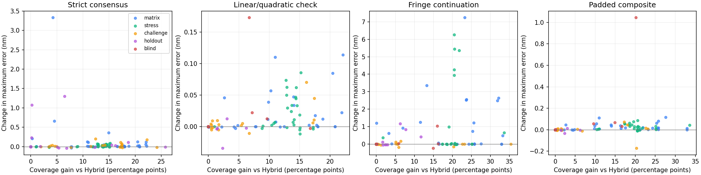
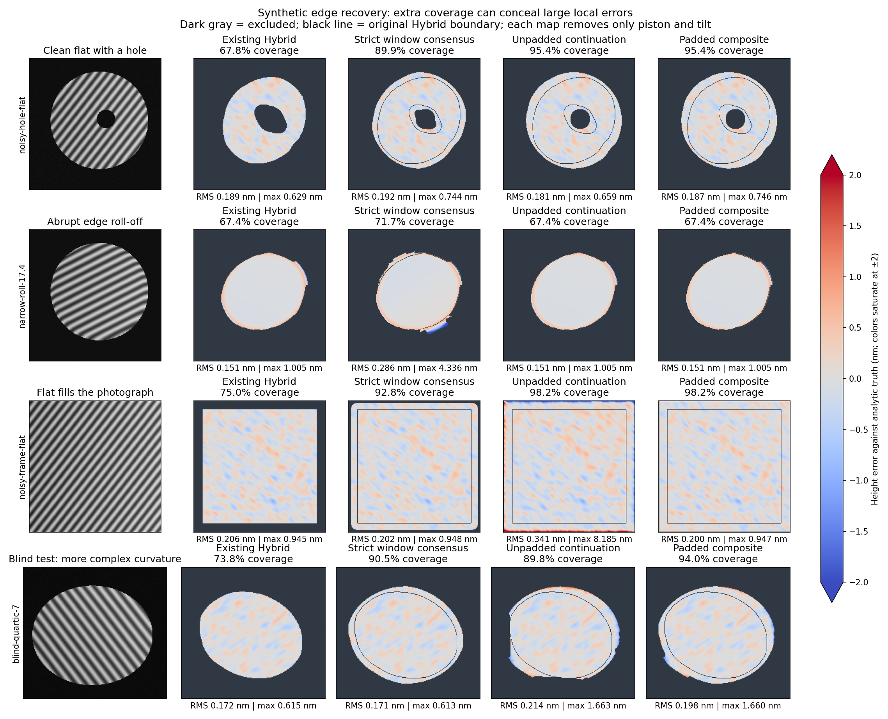

# Further fringe-edge recovery experiments

## Scope and decision

These are research implementations, not new production methods. The application’s Current and experimental Hybrid estimators are unchanged. The comparison-view work in the working tree is separate. Greater synthetic coverage does not establish accuracy on real parts; this study retains failures and does not claim full coverage.

3851 recorded evaluations (including repeated baselines and pilot reruns); 174 distinct scenes. Errors, if any, remain in the raw records. Final source hashes, dependency versions and the base Git revision are in `provenance.json`. The original 126 scenes were reused, followed by 24 asymmetric exploratory holdouts and 12 final confirmation scenes. The follow-up model check was designed after inspecting the exploratory holdouts, so those 24 are not an independent final test. The 12 confirmation scenes were specified and run after freezing the combined rule; their outcomes were not used to revise its thresholds. A separate padded variant was then developed after finding a frame-edge failure in the original matrix. Its checks reuse all suites, including the confirmation scenes; those checks were therefore exploratory for the padded variant. A further 12 scenes were then specified and run with the padded algorithm frozen: odd rectangular frames, quartic/two-bump surfaces, contrast falloff, gamma response, warped carrier and paired defects. No rule was revised against this final blind suite.

## Final padded-composite comparison

| Suite | Scenes | Hybrid coverage → composite | Hybrid RMS → composite (nm) | Largest maximum-error increase (nm) |
|---|---:|---:|---:|---:|
| matrix | 36 | 63.28% → 76.09% | 0.218 → 0.219 | 0.117 |
| stress | 60 | 64.21% → 73.17% | 0.259 → 0.259 | 0.086 |
| challenge | 30 | 61.58% → 65.64% | 0.935 → 0.932 | 0.072 |
| holdout | 24 | 52.72% → 53.32% | 2.789 → 2.789 | 0.013 |
| confirmation | 12 | 48.76% → 59.31% | 1.076 → 1.049 | 0.270 |
| blind | 12 | 57.81% → 62.92% | 1.381 → 1.369 | 1.045 |

These are software reconstruction errors on synthetic images, not instrument accuracy. Higher coverage does not repair errors already present in Hybrid. The final blind set is reported separately from the scenes used during development.

## What was implemented

- **Rejection accounting:** separate upstream mask losses from downstream rejections, and report exclusive first-failing local-fit gates: conditioning, contrast, image residual, window disagreement. The `reference_window_gates` counts describe the common 0.025-rad reference check before each variant’s extra rules, not all final admission failures. Upstream/downstream losses refer to the original Hybrid aperture. Physical-outline counts are evaluation-only; estimators do not receive analytic truth.
- **Adaptive window bank:** quadratic local harmonic fits at across/along sigma fractions (0.35, 0.175), (0.5, 0.25), and (0.5, 0.5) of fringe period, each checked against a 30% wider window. Same amplitude >15, condition <1000 and residual <4% amplitude checks as Hybrid. Fit windows exclude unselected image samples.
- **Interior anchoring:** unwrap each candidate, resolve its integer fringe order from at least 25 original Hybrid pixels with 90th-percentile phase agreement within 0.05 rad, remove failed bridges, and grow only through connected accepted fits. Existing Hybrid phase values and pixels are preserved exactly. New values never become anchors for later fits.
- **Consensus and growth controls:** compare union, two-window consensus, 0.01-rad strict agreement, removal of the one-period reach limit, and removal of the one-pixel reliability erosion. These are explicit alternatives, not silently loosened defaults.
- **Model diversity:** require the local quadratic phase to agree with a linear-amplitude/background fit within 0.01 rad, in addition to strict window consensus. This rejects some real curvature along with biased sharp-rim estimates.
- **Fringe continuation:** fit quadratic phase and illumination plus sinusoidal amplitude on the reliable interior, synthesize only outside the allowed aperture, then re-filter. Every real in-aperture input pixel remains unchanged. Admit only real selected pixels whose period-sized neighborhood has image-model RMS below 4% amplitude and which pass original-anchor checks. Synthetic pixels are never counted as measurements.
- **Globally checked continuation:** additionally require whole-aperture image prediction RMS ≤ max(1% amplitude, 1.5 × anchor-area image RMS). The checked composite takes model-checked local additions first, then accepted continuation only where still missing.
- **Frame padding:** a separate variant extends the same prediction two fringe periods beyond every photograph boundary before filtering, crops back, and restores the carrier-coordinate origin. It uses the same global/local admission gates. The padded composite takes model-checked local additions first, then padded continuation; the failed unpadded version remains in the results.
- **Negative/control ideas:** noise-aware residual floor (1.5 × median interior fit residual) and conditioning limit 10000 instead of 1000 were also tested.

## Results by suite

All heights and errors below are nm. Coverage is relative to the known physical aperture. Mean RMS is computed per scene then averaged. Worst Δ max is the largest increase in a scene’s maximum error relative to Hybrid. Added-area max uses a plane fitted on the original Hybrid domain only; this avoids fitting away new edge errors, but is itself affected by severe pre-existing unwrap errors.

### matrix (36 scenes)

| Method | N | Mean coverage % | Mean RMS nm | Worst Δ max nm | Worst added-area max nm |
|---|---:|---:|---:|---:|---:|
| Current | 36 | 41.18 | 0.289 | 2.375 | — |
| Hybrid | 36 | 63.28 | 0.218 | 0.000 | — |
| Guard removal | 36 | 77.27 | 0.251 | 4.522 | 5.710 |
| Window union | 36 | 79.52 | 0.259 | 4.545 | 5.710 |
| Window consensus | 36 | 76.75 | 0.240 | 3.294 | 4.482 |
| Strict consensus | 36 | 76.25 | 0.228 | 3.331 | 4.482 |
| Outward growth | 36 | 78.16 | 0.247 | 3.502 | 4.482 |
| No one-pixel erosion | 36 | 79.20 | 0.254 | 3.970 | 5.079 |
| Linear/quadratic check | 36 | 73.02 | 0.218 | 0.114 | 2.253 |
| Fringe continuation | 36 | 77.38 | 0.249 | 7.240 | 8.403 |
| Globally checked continuation | 36 | 72.26 | 0.228 | 7.240 | 8.403 |
| Checked composite | 36 | 76.09 | 0.228 | 7.279 | 8.403 |
| Padded, checked continuation | 36 | 72.26 | 0.219 | 0.055 | 0.665 |
| Padded composite | 36 | 76.09 | 0.219 | 0.117 | 2.253 |

### stress (60 scenes)

| Method | N | Mean coverage % | Mean RMS nm | Worst Δ max nm | Worst added-area max nm |
|---|---:|---:|---:|---:|---:|
| Current | 60 | 51.22 | 0.293 | 1.923 | — |
| Hybrid | 60 | 64.21 | 0.259 | 0.000 | — |
| Guard removal | 60 | 71.81 | 0.259 | 0.137 | 1.577 |
| Window union | 60 | 72.92 | 0.260 | 0.189 | 2.862 |
| Window consensus | 60 | 71.80 | 0.259 | 0.105 | 1.562 |
| Strict consensus | 60 | 71.70 | 0.259 | 0.086 | 1.483 |
| Outward growth | 60 | 72.70 | 0.259 | 0.105 | 1.562 |
| No one-pixel erosion | 60 | 73.24 | 0.261 | 0.590 | 3.006 |
| Linear/quadratic check | 60 | 70.07 | 0.259 | 0.086 | 0.550 |
| Fringe continuation | 60 | 72.67 | 0.284 | 6.262 | 7.074 |
| Globally checked continuation | 60 | 72.64 | 0.283 | 6.262 | 7.074 |
| Padded, checked continuation | 60 | 72.64 | 0.258 | 0.041 | 0.495 |
| Padded composite | 60 | 73.17 | 0.259 | 0.086 | 0.550 |

### challenge (30 scenes)

| Method | N | Mean coverage % | Mean RMS nm | Worst Δ max nm | Worst added-area max nm |
|---|---:|---:|---:|---:|---:|
| Current | 30 | 48.53 | 1.026 | 0.208 | — |
| Hybrid | 30 | 61.58 | 0.935 | 0.000 | — |
| Guard removal | 30 | 70.38 | 0.879 | 0.210 | 2.588 |
| Window union | 30 | 72.24 | 0.876 | 0.942 | 3.236 |
| Window consensus | 30 | 70.08 | 0.879 | 0.339 | 1.857 |
| Strict consensus | 30 | 69.92 | 0.878 | 0.198 | 1.841 |
| Outward growth | 30 | 71.05 | 0.873 | 0.339 | 1.857 |
| No one-pixel erosion | 30 | 71.37 | 0.877 | 0.809 | 2.887 |
| Linear/quadratic check | 30 | 64.71 | 0.928 | 0.070 | 1.017 |
| Fringe continuation | 30 | 66.16 | 0.938 | 0.178 | 2.233 |
| Globally checked continuation | 30 | 64.14 | 0.938 | 0.017 | 1.929 |
| Padded, checked continuation | 30 | 64.14 | 0.938 | 0.017 | 1.219 |
| Padded composite | 30 | 65.64 | 0.932 | 0.072 | 1.219 |

### holdout (24 scenes)

| Method | N | Mean coverage % | Mean RMS nm | Worst Δ max nm | Worst added-area max nm |
|---|---:|---:|---:|---:|---:|
| Current | 24 | 40.82 | 2.732 | 0.199 | — |
| Hybrid | 24 | 52.72 | 2.789 | 0.000 | — |
| Guard removal | 24 | 58.18 | 2.791 | 4.064 | 79.780 |
| Window consensus | 24 | 57.91 | 2.785 | 1.286 | 79.659 |
| Strict consensus | 24 | 57.48 | 2.784 | 1.301 | 79.659 |
| Outward growth | 24 | 58.10 | 2.785 | 1.286 | 79.659 |
| Linear/quadratic check | 24 | 53.32 | 2.789 | 0.013 | 1.253 |
| Fringe continuation | 24 | 54.26 | 2.800 | 1.169 | 2.206 |
| Globally checked continuation | 24 | 52.72 | 2.789 | 0.003 | 1.351 |
| Checked composite | 24 | 53.32 | 2.789 | 0.013 | 1.351 |
| Noise-aware residual | 24 | 62.04 | 2.797 | 2.153 | 79.659 |
| Relaxed conditioning | 24 | 59.24 | 2.829 | 5.638 | 127.722 |
| Padded, checked continuation | 24 | 52.72 | 2.789 | 0.003 | 1.345 |
| Padded composite | 24 | 53.32 | 2.789 | 0.013 | 1.345 |

### confirmation (12 scenes)

| Method | N | Mean coverage % | Mean RMS nm | Worst Δ max nm | Worst added-area max nm |
|---|---:|---:|---:|---:|---:|
| Current | 12 | 39.30 | 1.103 | 0.778 | — |
| Hybrid | 12 | 48.76 | 1.076 | 0.000 | — |
| Linear/quadratic check | 12 | 54.85 | 1.056 | 0.208 | 1.786 |
| Fringe continuation | 12 | 59.09 | 1.059 | 2.355 | 5.305 |
| Globally checked continuation | 12 | 58.69 | 1.055 | 0.257 | 1.739 |
| Checked composite | 12 | 59.31 | 1.049 | 0.270 | 1.786 |
| Padded, checked continuation | 12 | 58.69 | 1.055 | 0.257 | 1.739 |
| Padded composite | 12 | 59.31 | 1.049 | 0.270 | 1.786 |

### blind (12 scenes)

| Method | N | Mean coverage % | Mean RMS nm | Worst Δ max nm | Worst added-area max nm |
|---|---:|---:|---:|---:|---:|
| Current | 12 | 49.21 | 1.430 | 0.095 | — |
| Hybrid | 12 | 57.81 | 1.381 | 0.000 | — |
| Linear/quadratic check | 12 | 61.16 | 1.372 | 0.173 | 1.917 |
| Fringe continuation | 12 | 62.24 | 1.371 | 1.047 | 1.661 |
| Globally checked continuation | 12 | 62.23 | 1.371 | 1.047 | 1.661 |
| Padded, checked continuation | 12 | 62.23 | 1.371 | 1.046 | 1.660 |
| Padded composite | 12 | 62.92 | 1.369 | 1.045 | 1.917 |



## Interpretation

The unpadded composite failed on a noisy flat that fills the photograph: coverage rose from 75.0% to 98.2%, but maximum error rose from 0.945 to 8.224 nm. Global image-model agreement did not catch a filtering error at the frame boundary. Explicit two-period padding removes that particular failure; the table and example figure show its performance without discarding the failed run.



The fixed guard is a substantial source of lost area on clean, well-resolved surfaces. Removing it indiscriminately is unsafe: several windows can agree on the same biased estimate near abrupt roll-off. Outward growth increases reach but cannot create information. Relaxed conditioning and a noise floor increase coverage in some scenes, but can admit weak-rim or defect-related errors. A simple linear/quadratic check is more selective: it gives up some curvature coverage to avoid many of the sharp-rim regressions. Continuation is strongest on surfaces that its whole-image model actually explains; local image agreement alone is insufficient.

The final blind suite exposes a remaining continuation bias: `blind-quartic-7` gains coverage from 73.77% to 93.95%, but maximum error increases from 0.615 to 1.660 nm. The selective local bank alone reaches 90.51% with maximum error 0.613 nm. Continuation passes both image-model checks in this case; a good average intensity fit is not a sufficient guarantee of accurate phase at every newly admitted pixel. The frozen rule is retained, and this is a reason not to promote the combined method yet.

The checked composite preserves every original Hybrid value. Consequently it also preserves existing serious failures, including scratch-related fringe-order errors. Lower overall RMS after adding clean pixels must not be interpreted as fixing a scratch. The existing upstream illumination, modulation, connected-region and foldover gates remain in force, so these methods cannot recover all selected pixels. No 100%-coverage accuracy claim follows from these results.

## Error accounting and limits

Analytic height is used only after reconstruction to score each output. Sign is determined from the detected versus generated carrier direction, never chosen to minimize error. Only piston and tilt are fitted for scoring; no curvature, scale, registration or best-case sign correction is allowed. Common-area error, added-area error, full-mask error, removed original pixels, cap pixels and outside-physical pixels are retained in the CSV/JSON. The `seconds` field is cumulative elapsed time within one scene with shared fits; it is not an isolated per-method benchmark.

Do not promote the broad window union, relaxed conditioning, or unpadded continuation on these results. The selective local-fit and padded-composite paths are candidates for further experiments, not validated metrology options. The final blind suite probes non-quadratic phase, varying contrast and camera artifacts. Further work should target independently detecting existing fringe-order failures before extension. A multi-image method would also need registration, common fringe order and a physical acquisition protocol.

Fit agreement is correlated evidence from one image, not independent measurement or a calibrated uncertainty bound. This research implementation has not been ported into the browser worker or added to the UI. Real-part validation is still required.

## Next experiments worth pursuing

- Test whether spatially structured prediction residuals can distinguish model bias from camera noise before continuation is admitted. The blind quartic failure passes an RMS-only check.
- Hold out strips of reliable interior pixels when fitting the continuation model, then test prediction on those strips before extending outward. This tests extrapolation behavior rather than relying only on training-area agreement.
- Detect and flag existing fringe-order failures before combining results. Every variant here deliberately preserves original measurements, including their errors.
These are proposed follow-ups, not implemented results in this study.

## Verification

36 targeted tests passed across the recovery prototypes, production Hybrid and prior local-fit experiments. They cover original-value preservation, truth-independent admission, disconnected regions, bad anchor agreement, excluded-pixel independence, padded coordinate origin in both carrier directions, and retention of actual image pixels. Existing dependency deprecation warnings remain.

## Reproduce

```sh
export OPENBLAS_NUM_THREADS=1 MPLCONFIGDIR=/tmp/loupe-mpl
for suite in matrix stress challenge; do
  .venv/bin/python scripts/experiment-fringe-edge-recovery.py --suite "$suite" --output "/tmp/loupe-recovery-$suite.json"
  .venv/bin/python scripts/experiment-fringe-edge-recovery.py --suite "$suite" --methods bank-model-check continuation --output "/tmp/loupe-recovery-second-$suite.json"
done
.venv/bin/python scripts/experiment-fringe-edge-recovery.py --suite holdout --methods guard-free bank-consensus bank-strict bank-grow bank-noise-aware bank-conditioned --output /tmp/loupe-recovery-holdout.json
.venv/bin/python scripts/experiment-fringe-edge-recovery.py --suite holdout --methods bank-model-check continuation --output /tmp/loupe-recovery-second-holdout.json
for suite in matrix holdout; do
  .venv/bin/python scripts/experiment-fringe-edge-recovery.py --suite "$suite" --methods checked-composite --output "/tmp/loupe-recovery-final-$suite.json"
done
.venv/bin/python scripts/experiment-fringe-edge-recovery.py --suite confirmation --methods checked-composite --output /tmp/loupe-recovery-confirmation.json
for suite in matrix stress challenge holdout confirmation blind; do
  .venv/bin/python scripts/experiment-fringe-edge-recovery.py --suite "$suite" --methods padded-composite --output "/tmp/loupe-recovery-padded-final-$suite.json"
done
.venv/bin/python scripts/report-fringe-edge-recovery.py
.venv/bin/python scripts/plot-fringe-edge-recovery.py
```

Pilot and follow-up rows in the recorded dataset are retained for provenance; the commands above reproduce the suite tables. Source: `scripts/fringe_edge_recovery.py`; tests: `tests/test_fringe_edge_recovery.py`.

## Scientific guidance

The adaptive-fit experiments build on the local/windowed analysis motivation of [Qian (2004)](https://doi.org/10.1364/AO.43.002695) and the bias/noise discussion in [Gao & Qian (2012)](https://opg.optica.org/viewmedia.cfm?seq=0&uri=ao-51-3-328). [Massig & Heppner (2001)](https://doi.org/10.1364/AO.40.002081) reports fringe-extrapolation techniques to reduce border errors and motivates the continuation experiment. These implementations are our own model/anchoring tests, not reproductions of those published algorithms.
