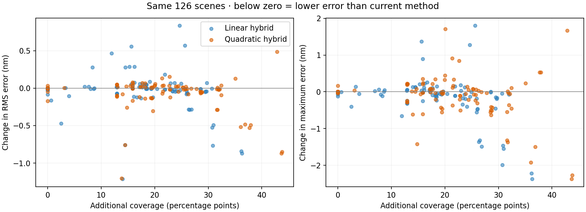

> Availability update: the quadratic candidate is now exposed as an opt-in experimental method in Analysis settings, on server and browser (maximum image side 1024 px). The current estimator remains the default. The text below records the original experiment and its limitations; its numerical results are unchanged.

# Hybrid fringe-edge experiment — 2026-10-25

Combining the methods is substantially safer than replacing the existing estimator everywhere. The quadratic hybrid is the strongest overall candidate in this sweep, but remains experimental: some sharp roll-off cases still get worse, and fallback preserves pre-existing errors around scratches. These checks are empirical admission rules, not calibrated uncertainty bounds. The application numerical default is unchanged.

## Method

The experiment runs the current bounded method first. A local harmonic fit then uses only in-aperture samples, refines the carrier twice, and restores the original carrier reference before mixing phases. A second fit with a 30% wider window checks stability. Both fits must have condition number below 1000, amplitude above 15 intensity units, residual below 4% of amplitude, and wrapped-phase disagreement below 0.025 rad (0.010 for the stricter variant). These intensity thresholds assume the existing 0–255 image convention. The same upstream illumination, modulation and foldover gates remain in place.

Accepted regions are eroded one pixel, must connect to at least 25 existing valid measurements, and must agree with those measurements at their 90th-percentile phase difference within 0.05 rad (0.02 for the stricter variant). Each component acquires its integer fringe order from this overlap. New pixels cannot lie more than one fringe period from the existing valid mask. Inside the shared area a short distance taper blends the estimates; elsewhere failed candidates fall back to the exact baseline phase. Previously excluded pixels remain excluded unless the candidate passes. All baseline pixels are retained. Neither analytic height, the known carrier nor the synthetic physical mask is used for admission.

Linear: window sigma 0.4 fringe period across / 0.2 along, guard factor 0.4. Quadratic: 0.5 / 0.25, guard factor 0.3. Full-frame square guards remain unchanged. Gates were fixed for the first hybrid sweep; the stricter and quadratic variants are explicit comparisons on the same fixtures, not independent validation after selection.

## Same 126 scenes

666 recorded evaluations, including repeated baselines and the earlier unrestricted refined fit on the 36-case matrix. All succeeded. The 36 original cases, 60 stress cases and 30 challenge cases are identical to the previous local-fit study. Error is measured against analytic height after removing only piston and tilt on each evaluated mask. Greater coverage changes the evaluated area; `common_rms_error_nm` and added-pixel metrics are included in the CSV.

| Suite | Method | Mean coverage | Mean RMS error (nm) | Lower RMS than current | Worst increase in max error (nm) |
|---|---|---:|---:|---:|---:|
| matrix | Current | 41.18% | 0.289 | 0/36 | 0.000 |
| matrix | Linear hybrid | 59.37% | 0.203 | 24/36 | 0.895 |
| matrix | Stricter linear | 55.53% | 0.279 | 22/36 | 0.895 |
| matrix | Quadratic hybrid | 63.28% | 0.218 | 16/36 | 1.710 |
| stress | Current | 51.22% | 0.293 | 0/60 | 0.000 |
| stress | Linear hybrid | 62.47% | 0.296 | 24/60 | 1.279 |
| stress | Stricter linear | 61.42% | 0.289 | 24/60 | 1.497 |
| stress | Quadratic hybrid | 64.21% | 0.259 | 25/60 | 0.230 |
| challenge | Current | 48.53% | 1.026 | 0/30 | 0.000 |
| challenge | Linear hybrid | 58.25% | 0.988 | 9/30 | 1.799 |
| challenge | Stricter linear | 58.14% | 0.991 | 9/30 | 1.839 |
| challenge | Quadratic hybrid | 61.58% | 0.935 | 9/30 | 0.845 |



## Important cases

| Scene | Method | Coverage | RMS error (nm) | Max error (nm) |
|---|---|---:|---:|---:|
| noisy-hole-flat | Current | 35.38% | 0.152 | 0.528 |
| noisy-hole-flat | Linear hybrid | 66.06% | 0.148 | 0.482 |
| noisy-hole-flat | Quadratic hybrid | 67.79% | 0.189 | 0.629 |
| stress-flat-17-7.9 | Current | 44.68% | 0.318 | 1.618 |
| stress-flat-17-7.9 | Linear hybrid | 71.56% | 0.035 | 0.128 |
| stress-flat-17-7.9 | Quadratic hybrid | 59.50% | 0.057 | 0.195 |
| narrow-roll-10.7 | Current | 44.65% | 0.291 | 1.389 |
| narrow-roll-10.7 | Linear hybrid | 61.35% | 0.168 | 1.648 |
| narrow-roll-10.7 | Quadratic hybrid | 64.73% | 0.348 | 3.099 |
| challenge-hole-11 | Current | 37.95% | 0.327 | 1.323 |
| challenge-hole-11 | Linear hybrid | 63.56% | 0.898 | 3.122 |
| challenge-hole-11 | Quadratic hybrid | 59.50% | 0.283 | 1.487 |
| challenge-scratch-119 | Current | 54.60% | 11.283 | 146.929 |
| challenge-scratch-119 | Linear hybrid | 68.61% | 10.070 | 147.062 |
| challenge-scratch-119 | Quadratic hybrid | 68.41% | 10.080 | 146.940 |

The quadratic hybrid increases coverage in 85/126 scenes and lowers RMS in 50/126. It removes zero baseline pixels and admits zero pixels outside the known synthetic physical aperture. These are results of this suite, not guarantees for photographs.

The stricter gate is not uniformly better: it can retain more of the biased baseline and introduce transitions between estimators. The quadratic variant reduces broad-curvature bias, but cannot recover genuinely unresolved narrow features reliably. Scratch fallback is particularly important: lower whole-mask RMS can partly result from adding cleaner pixels while retaining the original bad scratch values. It is not evidence that the scratch became measurable.

## Reproduce

```sh
export OPENBLAS_NUM_THREADS=1 MPLCONFIGDIR=/tmp/loupe-mpl
for suite in matrix stress challenge; do
  flag=""; [ "$suite" = matrix ] || flag="--$suite"
  .venv/bin/python scripts/experiment-fringe-local-fit.py $flag \
    --methods bounded hybrid:.4:.4:1 hybrid-strict:.4:.4:1 \
    --output "/tmp/loupe-hybrid-$suite.json"
  .venv/bin/python scripts/experiment-fringe-local-fit.py $flag \
    --methods bounded hybrid:.5:.3:2 \
    --output "/tmp/loupe-hybrid-quadratic-$suite.json"
done
.venv/bin/python scripts/report-fringe-hybrid.py
```

The recorded matrix also includes `refined:.4:.4:1` as an unrestricted comparator. Source implementation and focused tests are in `scripts/experiment-fringe-local-fit.py` and `tests/test_fringe_local_fit_experiment.py`. The quadratic candidate is available under Analysis method → Hybrid quadratic fit (experimental), in both engines. Current method remains the default. The integrated version tiles fits with full kernel halos, limits hybrid inputs to 1024 pixels on the longest side, and records method and fit/fallback counts in results. Browser analysis resizes larger images; use the same resolution and settings for comparisons. Safari runtime verification of the integrated hybrid remains outstanding.

Scientific background remains the windowed Fourier literature documented in the [preceding study](../fringe-local-fit/README.md). This is our own harmonic-regression and fallback experiment, not a reproduction of those algorithms.
