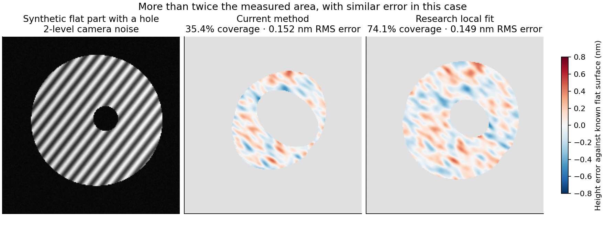
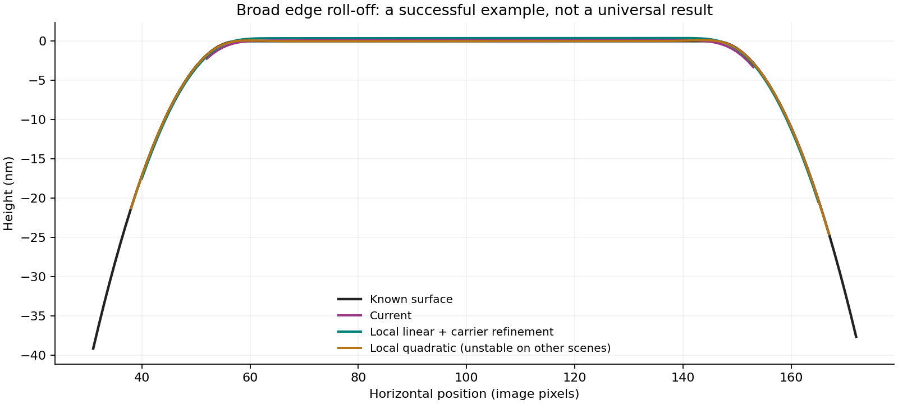
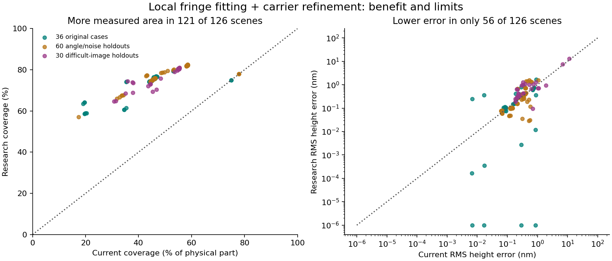

# Fringe-edge reconstruction experiments — 25 October 2026

**A local fringe fit can recover substantially more usable area. It is not yet
reliable enough to replace Loupe's current measurement method.** The prototype,
fixtures, measurements and failure cases are retained here; the application
still uses the conservative directional guard. Nothing in this experiment has
been deployed or added to normal PV/RMS calculations.

We recorded **930 analysis attempts on 126 distinct synthetic scenes**: 890
returned results, and 40 were refused by the experimental screening variants.
Repeated baselines, parameter sweeps and ablations count as separate attempts,
not independent specimens. The numerical inputs are independent analytic
intensity/height functions; this is software evidence, not instrument validation.

## What looks useful

| Scene / estimator | Measured physical area | RMS height error | Maximum absolute error |
|---|---:|---:|---:|
| Noisy flat part with hole — current | 35.4% | 0.152 nm | 0.528 nm |
| Same image — local linear fit + carrier refinement | **74.1%** | **0.149 nm** | **0.524 nm** |
| Sparse fringes, noisy flat part — current | 44.7% | 0.318 nm | 1.618 nm |
| Same image — local linear fit + carrier refinement | **74.6%** | **0.035 nm** | **0.184 nm** |
| Broad roll-off — current | 46.1% | 0.190 nm | 0.750 nm |
| Same image — local quadratic fit | **81.4%** | **0.070 nm** | **0.262 nm** |

The first two comparisons use `refined:.4:.4:1`, cases `noisy-hole-flat` and
`stress-flat-17-7.9`. The last uses `local:.5:.3:2`, case `broad-roll-17.4`.
These are successful examples; the quadratic method is **not** the recommended
universal estimator. Its weak-fringe failures below are much worse.



On the broad-roll example, the current measured region contains 7.594 nm true
PV and reports 8.107 nm; the quadratic fit measures a larger region containing
27.645 nm true PV and reports 27.758 nm. The change in PV is largely newly
observed shape, not a worsening of the same aperture. Neither method reaches
the entire physical rim.



## What was tried

1. **Shrink the existing guard.** Keep the existing phase estimator, halve the
   directional exclusion radii. This increases coverage but also false shape;
   the 36-case mean RMS error rises from 0.289 to 0.559 nm.
2. **Local linear harmonic regression.** At each pixel, jointly fit a planar
   background and planar sine/cosine amplitudes, weighted by an anisotropic
   Gaussian. Use only real samples inside the accepted aperture. Evaluating the
   fitted amplitudes at the target pixel avoids shifting the estimate inward
   when the window meets an edge. This is nine fitted coefficients, not a
   global plane removed from the measured surface.
3. **Local quadratic regression.** Eighteen coefficients allow more curvature
   within the fit. Broad roll-off improves, but poorly conditioned fits amplify
   noise, particularly when the remaining support is one-sided.
4. **Fit a second harmonic too.** Fifteen coefficients account for distorted
   fringe waveforms. This helps some harmonic cases but does not resolve sharp
   features, weak contrast or scratches generally.
5. **Refine the carrier.** Starting from the detected carrier, use the median
   neighboring residual-phase gradients in supported, adequately modulated
   regions to update its frequency, then refit. Two iterations greatly reduce
   false edge shape on some sparse-fringe flat scenes. No known truth is used
   to choose its sign, frequency or fit.
6. **Screen model mismatch.** Reject points whose local fit residual exceeds
   10% of fitted modulation amplitude or whose normal-matrix condition number
   exceeds 10,000. The thresholds are exploratory, not uncertainty bounds.
   A connected-component correction is essential after rejecting a scratch.

The window fraction is Gaussian sigma across fringes / carrier period; along
sigma is half, with research floors of 3 and 2 pixels. A guard fraction of .4
means 40% of the existing directional radii; full-frame square guards remain
unchanged. Existing illumination, modulation, initial connected-aperture and
plain-phase fold-over checks are retained. The local fit excludes exterior
samples, but upstream carrier detection and aperture detection still inspect
the original image. This is not a complete replacement analysis pipeline.

## The complete comparison prevents a premature default change

The local linear fit with carrier refinement was evaluated on all 126 scenes.
It increases coverage on **121**, leaves it unchanged on **5**, reduces RMS
error on **56**, and reduces maximum error on **62**. No candidate measured
pixels outside the known physical part, but that alone does not establish
validity: some accepted pixels on scratches have no usable fringe signal.

| Suite | Scenes | Current mean coverage | Research mean coverage | Current mean RMS error | Research mean RMS error |
|---|---:|---:|---:|---:|---:|
| Original boundary matrix | 36 | 41.2% | 71.6% | 0.289 nm | 0.288 nm |
| Angle/noise holdouts | 60 | 51.2% | 77.7% | 0.293 nm | 0.365 nm |
| Difficult-image holdouts | 30 | 48.5% | 76.3% | 1.026 nm | 1.238 nm |

These are unweighted means across synthetic scenes, not expected instrument
accuracy. Errors are evaluated over each method's own accepted region; the CSV
also reports common-region and newly added-region errors. More area often
includes more difficult real shape, so coverage and error must be read together.



CSV errors are rounded to six decimal places. The logarithmic plot places
values below 0.000001 nm at that display floor; they are not physical precision
claims.

### Important failures

- **Weak fringes:** on `auto-weak-all`, the quadratic fit raises maximum error
  from 2.512 to **56.727 nm** and false PV from 4.898 to **93.403 nm**. Its
  excellent broad-roll result does not justify making it the default.
- **Narrow roll-off:** the current method entirely excludes a narrow 40 nm rim
  feature. Local fitting reaches some of it, but smooths/distorts it. For
  `narrow-roll-17.4`, the quadratic fit reports 8.422 nm PV on an accepted
  region whose true PV is 6.975 nm; the rest of the rim is still missing.
- **Sparse carriers and steep/local shape:** frequency refinement cures some
  flat-scene bias, but not all curvature/feature bias. A better carrier is not
  a substitute for enough information within the local window.
- **A bright scratch fools the current pipeline too:** on
  `challenge-scratch-119`, the current method includes 539 synthetic
  fringe-free scratch pixels and reaches 146.929 nm maximum error. The
  connected, screened linear experiment rejects all scratch pixels and lowers
  maximum error to 0.834 nm, but retains only 29.7% of the part instead of 54.6%.
  This is a new limitation revealed by the tests, not evidence about a specific
  photographed part.
- **Disconnected regions:** simply screening the scratch and combining both
  sides can assign incompatible fringe orders. The ungrouped experiment gives
  49.355 nm RMS error on that scene; keeping the largest connected region gives
  0.284 nm. No arbitrary relative offset between disconnected regions is
  inferred from the known truth.
- **Over-rejection:** even after that correction, the screened linear and
  quadratic variants refuse 12/30 and 8/30 difficult scenes respectively.
  Harmonic waveforms and clipping can violate the simple model without making
  every height estimate useless. The screening rule is not production-ready.

## What to improve next

The worthwhile route is **local fitting with explicit support and model-quality
checks**, retaining the conservative result as a comparison. It needs a gate
that distinguishes noise amplification, insufficient fringe cycles, curvature
bias and waveform distortion. A small residual or agreement between two window
sizes alone does not prove accuracy. Any future UI trial should identify
experimental edge estimates separately and state exactly which part area contributes to each flatness result. The existing pipeline also needs a targeted
fringe-free-strip regression before accepting a scratch-detection change.

On this machine, the native prototype's single 1024×1024 linear fit took **3.17 seconds**, with
**763 MiB peak process RSS** (including Python/SciPy imports and allocations).
That is one local fit, not the full pipeline or the three-pass refined method,
and not a browser benchmark. The implementation is deliberately straightforward
research code; memory and repeated moment calculations need work before browser
integration. See `performance.json` for the recorded measurement.

## Reproduction and evidence

[results.csv](results.csv) contains every recorded attempt, including failures,
coverage, RMS/max error, common/added-pixel error, phase-derived PV, known PV on
the same retained aperture, invalid-region counts, conditioning and timing.
The `run` column distinguishes experiments and repeated baselines. Each
comparison removes only piston and tilt; it does not rescale heights, remove
curvature, register to truth, or choose a best-case sign. Carrier sign comes
from its direction relative to the synthetic carrier.

```sh
# Primary candidate on all three suites (126 scenes, 252 attempts).
OPENBLAS_NUM_THREADS=1 MPLCONFIGDIR=/tmp/loupe-mpl .venv/bin/python scripts/experiment-fringe-local-fit.py --methods bounded refined:.4:.4:1 --output /tmp/refined-matrix.json
OPENBLAS_NUM_THREADS=1 MPLCONFIGDIR=/tmp/loupe-mpl .venv/bin/python scripts/experiment-fringe-local-fit.py --stress --methods bounded refined:.4:.4:1 --output /tmp/refined-stress.json
OPENBLAS_NUM_THREADS=1 MPLCONFIGDIR=/tmp/loupe-mpl .venv/bin/python scripts/experiment-fringe-local-fit.py --challenge --methods bounded refined:.4:.4:1 --output /tmp/refined-challenge.json

# Main alternatives and difficult-image screening ablations.
OPENBLAS_NUM_THREADS=1 MPLCONFIGDIR=/tmp/loupe-mpl .venv/bin/python scripts/experiment-fringe-local-fit.py --methods bounded guard:1:.5 local:.4:.4:1 local:.5:.3:2 local:.6:.3:2 --output /tmp/local-matrix.json
OPENBLAS_NUM_THREADS=1 MPLCONFIGDIR=/tmp/loupe-mpl .venv/bin/python scripts/experiment-fringe-local-fit.py --challenge --methods bounded local:.4:.4:1 local:.5:.3:2 harmonic:.45:.35:1 screened:.4:.4:1 screened:.5:.3:2 screened-ungrouped:.4:.4:1 screened-ungrouped:.5:.3:2 --output /tmp/local-challenge.json

# Regenerate plots from the recorded CSV and deterministic fixtures.
OPENBLAS_NUM_THREADS=1 MPLCONFIGDIR=/tmp/loupe-mpl .venv/bin/python scripts/report-fringe-local-fit.py
# Measure one native fit in a fresh process.
OPENBLAS_NUM_THREADS=1 MPLCONFIGDIR=/tmp/loupe-mpl .venv/bin/python scripts/experiment-fringe-local-fit.py --benchmark-size 1024 --output /tmp/local-performance.json
# Numerical unit tests and focused pipeline regressions.
OPENBLAS_NUM_THREADS=1 MPLCONFIGDIR=/tmp/loupe-mpl .venv/bin/pytest -q tests/test_fringe_local_fit_experiment.py tests/test_fringe_boundary_experiments.py tests/test_fringe_edge_characterization.py tests/test_fringe_coverage.py
```

**Validation: 26 focused tests passed**, including 10 new research tests.
The new tests check known linear/quadratic amplitude models, masked/frame/hole
boundaries, multiple carrier directions, exterior-sample invariance, harmonic
separation, carrier refinement on a noisy sparse-carrier scene, and connected
scratch rejection. The source is research-only under `scripts/`; the
application's phase estimator and defaults have not been changed by this work.

## Scientific context

[Qian Kemao (2004), *Windowed Fourier transform for fringe pattern analysis*](https://doi.org/10.1364/AO.43.002695)
provides primary background on local filtering and matching for phase extraction
from a single carrier-fringe image. [Gao & Qian (2012), *Statistical analysis for
windowed Fourier ridge algorithm in fringe pattern analysis*](https://opg.optica.org/viewmedia.cfm?seq=0&uri=ao-51-3-328)
discusses the local phase model, noise and estimation bias. These informed the
experiment direction; this Gaussian weighted harmonic regression is a separate
prototype, **not** a reproduction of their WFR algorithm. Its numerical claims
come from the recorded experiments, not from transferring published accuracy
claims to Loupe. The existing Fourier/unwrapping references remain in the main
README.
